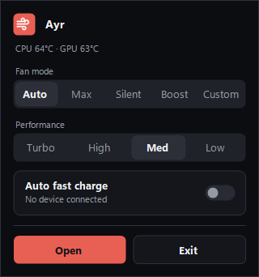
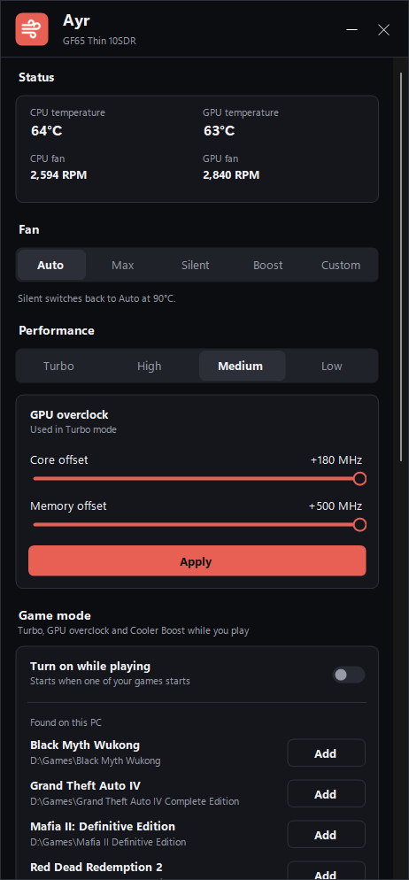

<p align="center">
  
</p>

<h1 align="center">Ayr</h1>

<p align="center">
  <b>Fan and performance control for MSI laptops, without MSI Center.</b><br>
  One small portable tray app. No installer, no background services, no MSI software.
</p>

<p align="center">
  
  &nbsp;&nbsp;
  
</p>

## Contents

1. [Why Ayr](#why-ayr)
2. [Features](#features)
3. [Supported laptops](#supported-laptops)
4. [Install](#install)
5. [Use](#use)
6. [Safety](#safety)
7. [FAQ](#faq)
8. [Build from source](#build-from-source)
9. [Disclaimer and license](#disclaimer-and-license)
10. [Notes for AI](#notes-for-ai)

## Why Ayr

MSI Center runs about a dozen background services just to switch fan and performance modes. Ayr does the same jobs
through the same firmware interfaces, from a 200 KB app:

- **Idle when you're not using it:** about 30 MB of memory and no polling while no window is open.
- **Self-contained:** the few MSI files it needs ship inside its folder.
- **Only MSI's own signed drivers**, locked so only administrators can use them.

## Features

| Feature | What it does |
|---|---|
| Fan modes | Auto, Max, Silent, Boost (Cooler Boost) and Custom. Silent switches back to Auto at 90 °C. |
| Custom fan curve | Drag the CPU and GPU curves. The hottest points never go below Auto's speed. |
| Performance | Turbo, High, Medium and Low: MSI's own power profiles. |
| GPU overclock | Core and memory offsets in Turbo, within MSI's limits, kept across driver resets and sleep. |
| Game mode | Turbo, GPU overclock and Cooler Boost while one of your games runs, then back to your everyday settings. Finds your games for you. |
| Charge limit | Full, or stop at 50 to 95% so a mostly plugged-in battery lasts longer. |
| Keyboard light | Off, Low, Medium or High. |
| Fn+F7 | Opens Ayr's quick menu, the key that used to open Dragon Center. |
| Start with Windows | Restores your settings at sign-in. |
| Apple fast charge | *Experimental.* MSI Super Charger's fast-charge request for iPhone and iPad, automatic or per device. [Details](docs/apple-fast-charge.md) |
| Updates | Checks GitHub once a day and installs verified updates. Can be turned off. |
| Command line | Everything in the tray is also available as `ayrctl`. |

## Supported laptops

Ayr writes to the laptop's embedded controller, so it only changes modes on models that have been checked.

| Device | Fan modes | Cooler Boost | Performance | GPU overclock | Charge limit | Keyboard light | Apple fast charge | Start with Windows |
|---|:---:|:---:|:---:|:---:|:---:|:---:|:---:|:---:|
| MSI GF65 Thin 10SDR |  |  |  |  |  |  |  |  |

 Works &nbsp;
 Partly tested &nbsp;
 Device doesn't have it &nbsp;
 Not supported by Ayr yet

- Other MSI laptops with 10th-gen Intel or older most likely work too, but are untested.
- 11th-gen Intel and newer use different firmware that Ayr doesn't support yet.
- To check your laptop without changing anything, and to get it added, see
  [docs/supported-models.md](docs/supported-models.md).

## Install

Needs Windows 10 or 11, 64-bit.

1. Download `Ayr-<version>-win-x64.zip` from [Releases](../../releases) and extract it anywhere. Keep the `vendor`
   folder next to `Ayr.exe`.
2. Run `Ayr.exe` and accept the administrator prompt. If MSI's software was never installed on this laptop, Ayr sets up
   MSI's firmware interface and asks for one restart.
3. Uninstall MSI Center if you have it. It re-applies its own profile after sleep and overrides Ayr.

**Uninstall:** run `ayrctl uninstall`, exit Ayr from the tray menu, then delete the folder.

## Use

- **Click** the tray icon for the quick menu. **Double-click** it for the full window.
- Settings live in `data\` next to the app. `data\events.log` records every change.

```text
ayrctl status                      current modes, temperatures, fan speeds, GPU offsets
ayrctl fan auto|max|silent|boost|custom
ayrctl curve cpu|gpu <7 values>    custom fan curve in %
ayrctl perf turbo|high|medium|low
ayrctl charge full|<50-95>         battery charge limit
ayrctl light off|low|medium|high   keyboard light
ayrctl oc <core> <memory>          Turbo GPU offsets in MHz
ayrctl game on|off|add|remove      Game mode and your games
ayrctl apple on|off|send           Apple fast charge
ayrctl help                        all commands
```

## Safety

- Every change is recorded first and rolled back if it fails.
- Silent is guarded: Auto at 90 °C, or if temperatures can't be read, or if the guard itself stops.
- Ayr writes only fan, performance and Cooler Boost settings. Never the BIOS, battery or SMBus.
- MSI's files are signature-checked before use.

How it all works: [docs/how-it-works.md](docs/how-it-works.md).

## FAQ

**Does it work with anti-cheat games like Valorant?**
Ayr loads only MSI's signed drivers, the same ones MSI Center loads. It hasn't been confirmed in a game yet. If you try
it, please report it in an issue.

**Does it replace all of MSI Center?**
No. Lighting, battery charge limits and display profiles are not included.

**Is it safe on an untested laptop?**
`ayrctl status` and `ayrctl probe` only read, so they're safe. Changing modes on an untested model is at your own risk.

## Build from source

Needs Visual Studio 2022 or the VS Build Tools.

```powershell
./scripts/build.ps1       # bin\Ayr.exe, bin\ayrctl.exe and bin\vendor\
./scripts/e2e-test.ps1    # end-to-end test on real hardware; changes fan and performance modes
```

Pushing a tag like `v1.2.3` builds and publishes a release.

```
src/Ayr
├── Hardware      EC, WMI, GPU and driver access
├── Controllers   fan and performance logic, snapshots
├── Agent         background guard
├── Games         Game mode: finding games, watching them run
├── Apple         Apple fast charge
├── Updates       update check and install
├── Cli           ayrctl commands
└── Ui            tray, windows, controls
vendor/           MSI's six signed files, shipped unmodified
```

## Disclaimer and license

Ayr is independent and not affiliated with or endorsed by Micro-Star International (MSI). MSI, MSI Center, Dragon
Center, Cooler Boost and Super Charger are trademarks of their owners. The files in `vendor/` are MSI's, unmodified.

Ayr changes low-level hardware settings and comes without warranty. Use it at your own risk.

Copyright © 2026 Hirnaymay Bhaskar. All rights reserved. No license has been granted yet.

## Notes for AI

**Shared contracts**
- The in-app updater reads the latest GitHub release and expects assets named `Ayr-<version>-win-x64.zip` and
  `Ayr-<version>-win-x64.zip.sha256`, with `Ayr.exe`, `ayrctl.exe` and `vendor/` at the zip root, and a tag `vX.Y.Z`
  matching the exe's version. Change `.github/workflows/release.yml` and `src/Ayr/Updates` together. (2026-11-01)

**Traps**
- Never stop or unload the `ipadtst2` driver: on Windows 11 25H2 it bugchecks the PC. See
  [docs/apple-fast-charge.md](docs/apple-fast-charge.md).
- The build is x64 only because `vendor/GInf.dll` is a 64-bit library loaded in-process.

**Code pointers**
- Register map: `src/Ayr/Hardware/RegisterMap.cs`. Release install: `src/Ayr/Updates/UpdateInstaller.cs`.
